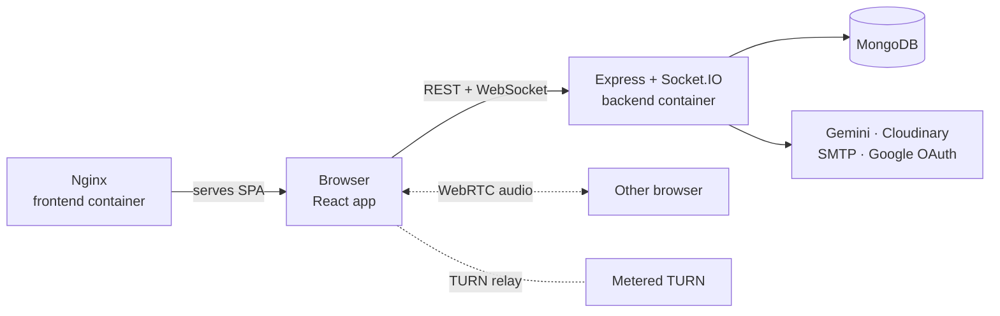
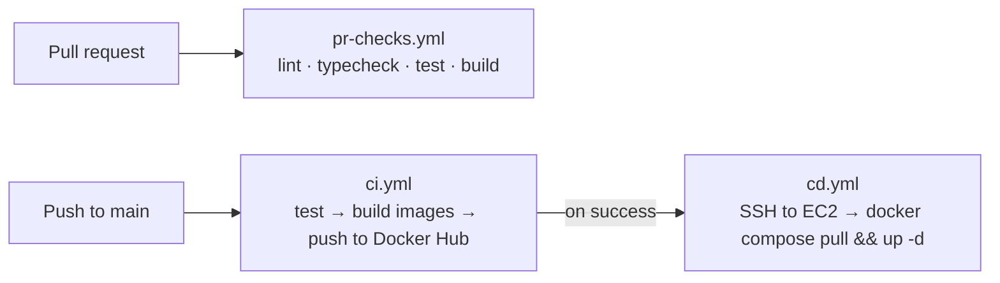

<div align="center">


# Mixi

**A full-stack social network with real-time chat, voice calls and AI chat assistance.**


<!-- TODO: add links once available
[Live demo](https://your-domain) · [Video demo](https://youtu.be/...)
-->

</div>

## Overview

Mixi lets people find friends, post to a shared feed, chat one-to-one or in groups, and call each other by voice, all in real time. Gemini-powered tools can summarize a long conversation or suggest replies.

Practice project covering the full product cycle: REST API and WebSocket backend, a strict-TypeScript React frontend, automated tests, Docker, and a CI/CD pipeline that deploys to AWS EC2.

**Demo account** (on the deployed server): `solilyoung5@gmail.com` / `LOL292002`

<!-- TODO: add screenshots, e.g.
| Feed | Chat | Voice call |
| :---: | :---: | :---: |
|  |  |  |
-->

## Features

### Authentication & account
- Sign up with email OTP verification; sign in with email/password or **Google OAuth**
- JWT sessions, forgot / reset / change password
- Rate limiting on login and OTP endpoints

### Social
- Profiles with avatar upload (Cloudinary, resized with `sharp`) and user search
- Friend requests: send, accept, decline, cancel, unfriend
- News feed: create, edit and delete posts; likes; nested comments with replies and comment likes

### Real-time chat (Socket.IO)
- One-to-one and **group chats** (rename, add or remove members, leave)
- Text and image messages, delete message, hide or delete conversations
- Typing indicators, **delivered / read receipts**, online / away / offline presence

### Voice calls (WebRTC)
- One-to-one voice calls with ringing, accept, decline, cancel and end
- Signaling over Socket.IO, TURN relay (Metered) for users behind strict NATs
- Call history saved in the chat (missed, declined, ended, with duration)

### AI assistance (Google Gemini)
- Summarize a conversation
- Suggest replies based on recent messages

## Tech stack

| Layer | Technologies |
| --- | --- |
| Frontend | React 18, TypeScript (strict), Vite, Tailwind CSS 4, React Router, Zustand, Axios, Socket.IO client |
| Backend | Node.js, Express, Socket.IO, Mongoose, Zod validation, JWT, bcrypt, Helmet, express-rate-limit |
| Database | MongoDB |
| Integrations | Google OAuth, Gemini API, Cloudinary, Nodemailer (SMTP), Metered TURN |
| Testing | Vitest, Supertest, mongodb-memory-server, React Testing Library |
| DevOps | Docker, Docker Compose, Nginx, GitHub Actions, Docker Hub, AWS EC2 |

## Architecture



The backend is layered as **routes → controllers → services → models**. Business logic is in `services/`, grouped by domain (`auth`, `user`, `friend`, `chat`, `post`). Request bodies are validated with Zod in `validation/`.

```
backend/src
├── routes/        # /auth /users /friends /chat /posts /calls
├── controllers/
├── services/      # domain logic (chat/ai holds the Gemini features)
├── models/        # User, FriendRequest, Conversation, Message, Post
├── middlewares/   # auth, rate limits, errors
├── validation/    # Zod schemas
└── socket.js      # presence, typing, receipts, call signaling

frontend/src
├── pages/  layouts/  components/
├── hooks/         # auth, chat (incl. useVoiceCall), profile, post
├── stores/        # Zustand
├── lib/           # API client, socket, helpers
└── types/         # shared API and socket types
```

## Getting started

### With Docker (recommended)

Only Docker is required.

```bash
git clone https://github.com/Startace296/Mixi.git
cd Mixi
docker compose up --build
```

| Service  | URL |
| -------- | --- |
| Frontend | http://localhost:3000 |
| Backend  | http://localhost:5000 |
| MongoDB  | internal to Docker (`mongo-data` volume) |

The local database starts empty, so register a new account. Stop with `docker compose down`; add `-v` to also wipe the database.

Optional features (email OTP, image upload, AI, Google login, TURN for calls) need keys. Copy `.env.example` to `.env` in the repo root, fill in what you need, then run `docker compose up --build` again. A feature whose keys are empty stays off; everything else still works.

If a port is already taken, choose other ones and rebuild (the frontend bakes the backend URL in at build time):

```bash
BACKEND_PORT=8055 FRONTEND_PORT=3033 docker compose up --build
```

### Without Docker

Requires Node.js and a MongoDB instance.

```bash
cd backend && npm install && npm run dev    # needs backend/.env with MONGODB_URI and JWT_SECRET
cd frontend && npm install && npm run dev
```

## Testing

```bash
# backend: integration tests against an in-memory MongoDB, incl. Socket.IO
cd backend && npm run lint && npm test

# frontend
cd frontend && npm run typecheck && npm run lint && npm test && npm run build
```

## CI/CD and deployment



- `.github/workflows/pr-checks.yml` runs on every pull request into `main`: backend lint and tests, frontend lint, type check, tests and build. It never deploys.
- `.github/workflows/ci.yml` runs on every push to `main`: backend tests and frontend lint, then builds both images and pushes them to Docker Hub. The frontend image gets `VITE_API_URL=http://<EC2_HOST>:5000` at build time.
- `.github/workflows/cd.yml` runs after a successful CI run: it SSHes into the EC2 host and runs `docker compose pull && docker compose up -d` in `~/app`.

`docker-compose.prod.yml` is the production stack (prebuilt images, no MongoDB container, settings from `backend/.env`). On the server it is used as `~/app/docker-compose.yml`. `docker-compose.yml` is the local stack described above.

Voice calls need the page to be served over HTTPS (or from `localhost`): browsers only allow microphone access in a secure context. On a plain `http://<EC2_HOST>` deployment calls cannot start.

## Contributing: frontend conventions

All of `frontend/src` is TypeScript (strict mode). Tests under `frontend/tests` are still JavaScript; `tsconfig.json` keeps `allowJs` on (with `checkJs` off) so they keep running unchanged. Before pushing, run `npm run typecheck`, `npm run lint`, `npm test` and `npm run build`.

API and socket payload types live in `frontend/src/types/` (`User`, `Message`, `Conversation`, `Post`, `Friend`, and one response type per endpoint in `types/api.ts`); import them with `import type { ... } from '../types'`. In `catch` blocks use `getErrorMessage(error, fallback)` from `lib/errors.ts`, since `error` is `unknown` in strict mode. What `MainLayout` passes to its child routes is typed as `MainOutletContext` (read it with `useOutletContext<MainOutletContext>()`).

Where things go in `frontend/src`:

- `types/`: API data (`user`, `chat`, `post`, `friend`, `api`, `socket`) plus types shared by several components or hooks (`call`, `ui`: callbacks such as `OpenProfileHandler`, `ChatThread`, `PostActionHandlers`). A `XxxProps` interface stays next to its component.
- `hooks/`: grouped by domain (`auth/`, `chat/`, `profile/`, `post/`), each with an `index.ts`, so imports read `import { useSignIn } from '../hooks/auth'`. `post/usePostList` holds the paginated post list and every post action, used by the home feed and the profile page.
- `lib/`: `api/` (one file per backend area, all re-exported from `lib/api/index.ts`; always import from `lib/api`, because tests mock that path), `chat/`, `format/`, `navigation/`, plus `socket.ts` and `errors.ts` at the top level.
- `components/common/`: pieces reused across sections (`ConfirmDialog`, `SidebarNav`).
- A large component keeps its file and moves its sub-components into a folder named after it, e.g. `chat-comp/ChatHeader.tsx` + `chat-comp/chat-header/`.
